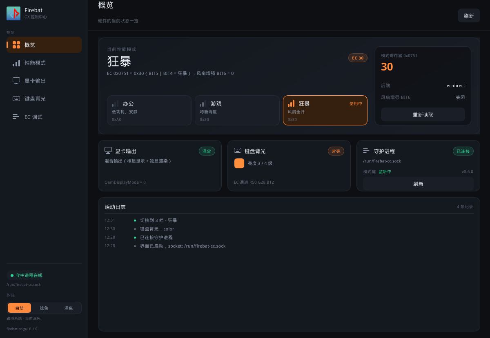
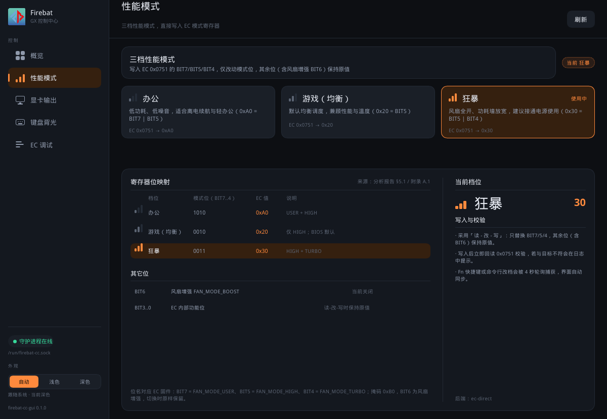
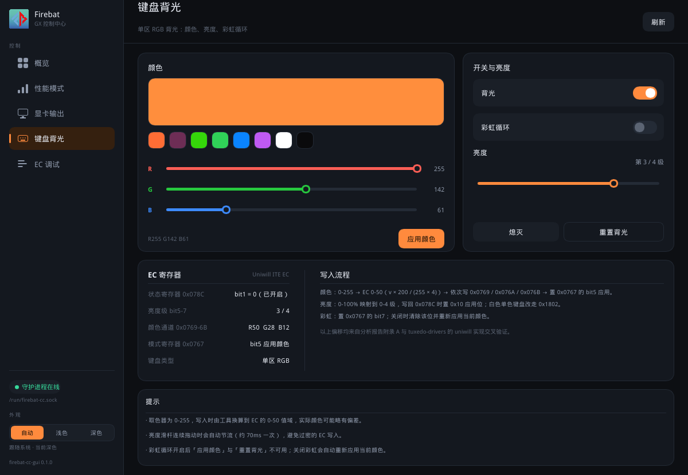
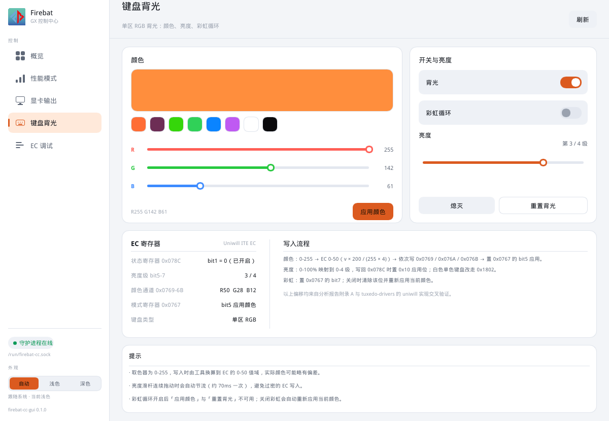
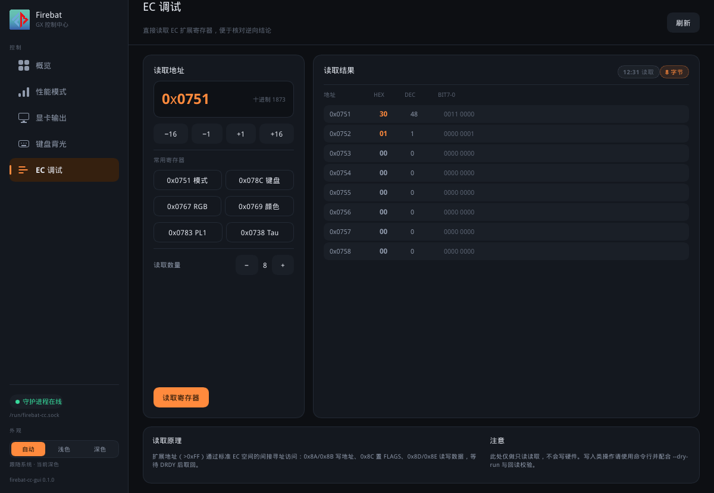

# firebat-cc-gui

Firebat GX 控制中心的 Linux 图形前端，使用 [Slint](https://slint.dev) 编写（Rust）。
界面完全用手绘组件实现，不依赖任何系统控件库；X11 与 Wayland 均可运行。

前端**不直接访问硬件**，而是通过 Unix domain socket 与
[`firebat-cc serve`](../docs/serve-协议.md) 守护进程通信，因此 GUI 进程不需要 root 权限。

## 功能

| 页面 | 内容 |
|---|---|
| 概览 | 当前性能模式、模式寄存器原始值、显卡/背光/连接状态速览、活动日志 |
| 性能模式 | 办公 / 游戏 / 狂暴三档切换，附寄存器位映射参考表 |
| 显卡输出 | 混合输出 / 独显直连，写入 UEFI 变量（带二次确认与重启提示） |
| 键盘背光 | 单区 RGB：颜色预设与取色、亮度滑杆、彩虹循环、开关与重置 |
| EC 调试 | 任意 EC 扩展寄存器只读读取，常用地址一键跳转，十六进制/二进制展示 |

其他：

- 外观三态：**跟随系统（默认）** / 浅色 / 深色。自动模式从 gsettings、GTK、
  KDE 配置推断系统深浅，运行中每 5 秒复检，桌面切换深色时界面随之切换；选择会写入
  `~/.config/firebat-cc/gui.conf`
- 危险操作（独显直连写入、狂暴档切换）走统一的确认对话框
- **运行时保持监听模式**：连上守护进程后自动发 `listen {enable:true}`，由守护进程
  轮询 EC 0x0751，按下性能模式键后按 办公→游戏→狂暴 推进档位并推送 `mode-changed`，
  界面即时跟随（概览页「模式键 / 监听中」可确认状态）
- 4 秒轮询作为兜底：守护进程重启、事件丢失时也能自愈
- 亮度拖动自动节流，避免过密的 EC 写入

## 截图







## 构建

需要 Rust 1.85+ 与系统图形库（winit 后端）：

```bash
# Arch
sudo pacman -S --needed base-devel pkgconf libxkbcommon wayland fontconfig freetype2
# Debian/Ubuntu
sudo apt install build-essential pkg-config libxkbcommon-dev libfontconfig1-dev libfreetype6-dev

# 在仓库根目录构建整个工作区（CLI + GUI）
cargo build --release
# 产物：target/release/firebat-cc-gui（单文件，可复制到任意位置）

# 只构建 GUI
cargo build --release -p firebat-cc-gui
```

## 运行

先启动守护进程（需要 root，因为要访问 EC）：

```bash
sudo modprobe ec_sys write_support=1
sudo ./target/release/firebat-cc serve          # 默认 /run/firebat-cc.sock
```

再以普通用户启动界面（以下命令均在仓库根目录执行）：

```bash
./target/release/firebat-cc-gui
./target/release/firebat-cc-gui --socket /tmp/fb.sock   # 自定义 socket
FIREBAT_CC_SOCK=/tmp/fb.sock ./target/release/firebat-cc-gui
```

守护进程没启动时界面照常打开，只是停留在「未连接」状态，并提示需要执行的命令。

真机排查可用无界面自检（不需要图形环境，也不需要开窗口）：

```bash
./target/release/firebat-cc-gui --self-test [--socket /tmp/fb.sock]
# 依次发 kb status → kb reset → kb status，打印前后 EC 颜色并校验回读一致
```

## 无真机联调

`gui/tools/mock-daemon.py` 是一份纯内存实现的模拟守护进程，支持协议中的全部命令，
用于在没有 Firebat 硬件（或不想写 EC）的机器上调试界面：

```bash
python3 gui/tools/mock-daemon.py /tmp/fb-mock.sock &
./target/release/firebat-cc-gui --socket /tmp/fb-mock.sock
```

模拟端会打印收到的每条请求，便于核对参数格式。

## 离线渲染（截图 / 视觉回归）

无显示器环境（CI、SSH）也能把五个页面渲染成图片：

```bash
cargo run --release -p firebat-cc-gui --example screenshot -- /tmp/firebat
# 输出 /tmp/firebat-0..4.ppm、-light.ppm、-confirm.ppm（P6 格式，可用 ffmpeg 转 PNG）
ffmpeg -i /tmp/firebat-0.ppm /tmp/firebat-0.png
```

该示例还会顺带跑一次滑杆交互回归（派发 PointerMoved / PointerPressed 到 R 通道滑杆），
校验「纯悬停不改数值、按下跳转、按住拖动跟随」三种行为，输出形如：

```
滑杆交互回归：悬停 255 → 255（通过：未改变），按下 → 17（通过：已改变），拖动 → 157（通过：跟随拖动）
```

## 目录结构

```
gui/                            # Cargo 成员包 firebat-cc-gui（构建产物在仓库根 target/）
├── build.rs                    # slint-build：编译 ui/*.slint
├── ui/
│   ├── app.slint               # 主窗口：侧栏、顶栏、页面容器、确认框、轻提示
│   ├── state.slint             # 共享状态 global（Backend / Nav）与回调声明
│   ├── theme.slint             # 深/浅色配色
│   ├── widgets.slint           # 手绘基础组件（卡片、按钮、滑杆、开关、徽章…）
│   ├── assets/logo.png         # 官方 Logo（见下），编译期嵌入
│   └── pages/*.slint           # 五个页面
├── src/
│   ├── main.rs                 # 回调接线、状态映射、轮询
│   └── client.rs               # serve 协议的 Unix socket 客户端（JSON 行）
├── examples/screenshot.rs      # 软件渲染器离线出图
└── tools/mock-daemon.py        # 协议级模拟守护进程
```

## 数据流

```
用户操作 → Slint 回调 → main.rs 起线程 → client.rs 发一行 JSON →
firebat-cc serve 操作 EC/UEFI → 响应 → invoke_from_event_loop →
写回 Backend 属性 → 界面自动刷新

模式键（EC 侧主动变化）→ serve 监听线程轮询 0x0751 → 推进档位并广播
{"event":"mode-changed"} → client 读线程分发 → handle_event → 界面刷新
```

`client.rs` 的读线程独占读取 socket：响应按 `id` 交给等待方，事件直接推给界面，
因此空闲时也能毫秒级收到 `mode-changed`，不必等下一次轮询捎带。

界面状态全部集中在 `ui/state.slint` 的 `Backend` global 里，Rust 侧只做「协议 ↔ 属性」
的映射，因此新增页面不需要改动通信层。

## 说明

- 外观检测顺序：`FIREBAT_CC_THEME=dark|light` 环境变量（仅调试用，优先生效）→
  `gsettings get org.gnome.desktop.interface color-scheme` → GTK 4/3 的
  `settings.ini`（`gtk-application-prefer-dark-theme`）→ KDE `kdeglobals`
  `[Colors:Window] BackgroundNormal` 的亮度。都探测不到时按深色显示。
  排查用 `./target/release/firebat-cc-gui --print-theme`，会打印配置路径、探测结果与最终解析。
- 界面左上角与窗口图标使用官方 Logo：`ui/assets/logo.png` 取自
  `reference/windows/TF_ControlCenter_5.49.51.44GX_Firebat/logo/gamingcenter_Firebat.ico` 内嵌的
  256×256 PNG（同目录的 `logo.png` 只有 48×48，放大后发虚）。更换 Logo 时直接替换该文件
  重新编译即可（`@image-url` 在编译期嵌入，不依赖运行时路径）。
- 显卡输出的 0/1 与混合/独显对应关系来自逆向推断，若与本机不符，用 CLI 的
  `--hybrid-value` / `--dgpu-value` 覆盖后重启守护进程。
